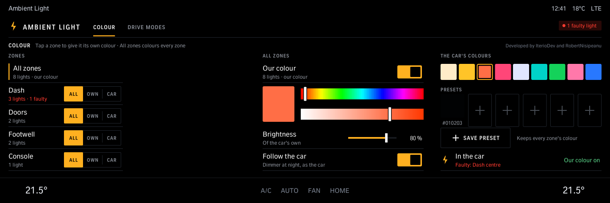
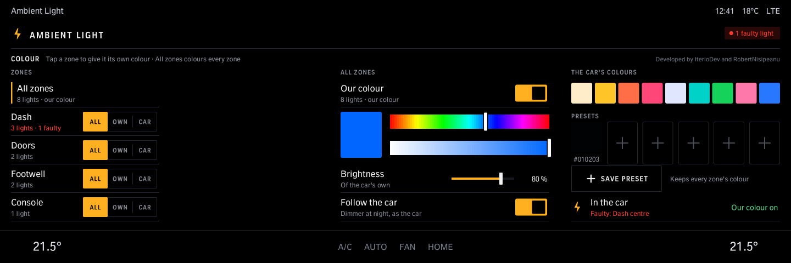
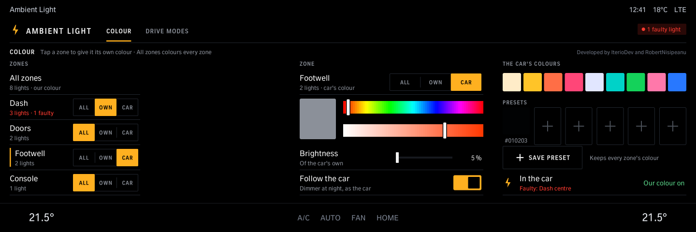
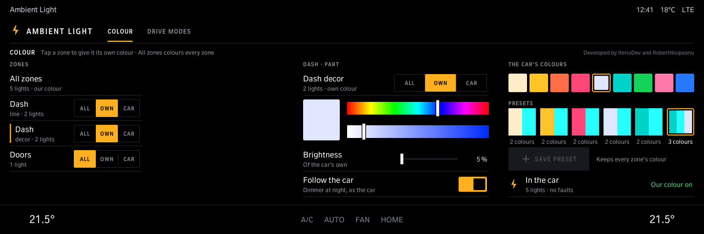
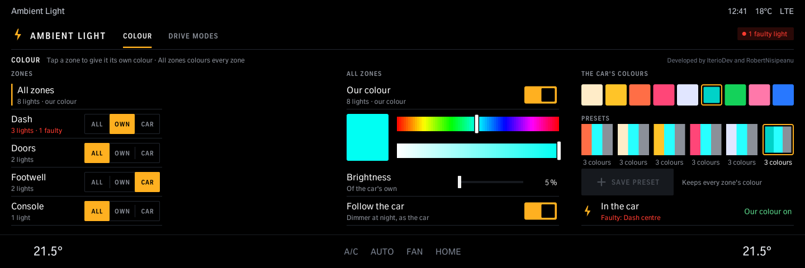
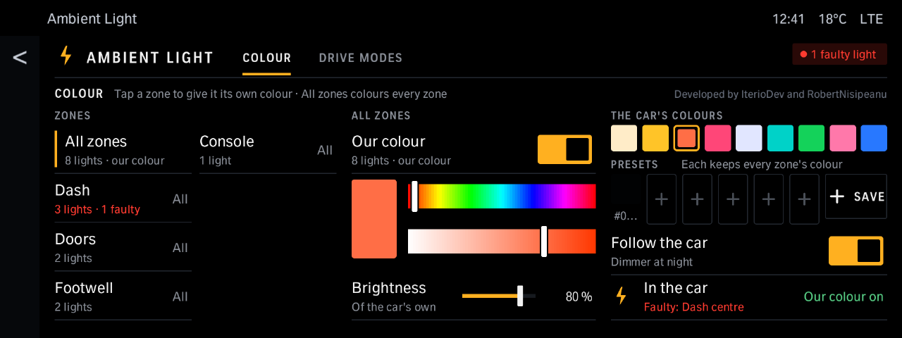

# Ambient Light

Any colour on the interior ambient light, not only the car's own presets, on one screen: your car's zones in a list (dash, doors, footwell, console, seats, roof: the ones it has), a colour bar for any shade, brightness (or follow the car's, dimmer at night), the car's colours as starting points and six presets of your own that keep every zone's colour. Each zone can follow the main colour, have its own, or keep the car's. A zone with two kinds of light (an X6's dash: a line above, decor below) shows as two rows, each with its own colour. Works while the car's own ambient light is switched on. Needs the Comfort tool (the Store installs it with the app).

Version 1.2.1 · iDrive 7 and 8 · package `iteriodev_ambient` · [all apps and how to install](../../README.md)

> [!NOTE]
> The colour route is run on a car (an M4, BDC_G05: custom colours on all eight light modules, Comfort 0.1.3). Comfort 0.1.4 runs on that car and finds its lights and zones. The 1.1.1 screen is not run on a car yet. iDrive 7 (1.2.0): not run on an iDrive 7 car yet.

## Screens

Screens from the app's offline test against a simulated car, so the values are made up.

### Colour

All zones picked: the colour bars and the car's colours set the main colour.

Drag the colour bars; the lights follow (at most four updates a second reach the car).

### Zones

Tap a zone's name to colour it with the bars; its All / Own / Car buttons give it the main colour, its own, or the car's.

A dash with a line and decor: two rows, each its own colour.

### Presets

Save preset keeps the whole look: the main colour and every zone's (six at most, the oldest goes). Tap one to bring it all back.

### iDrive 7

The same page on iDrive 7's smaller screen: each zone shows All / Own / Car as text; tap one, then set it with the buttons in the middle.
