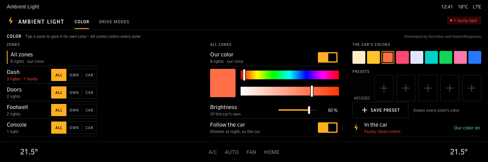
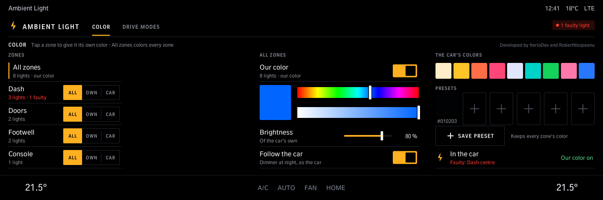
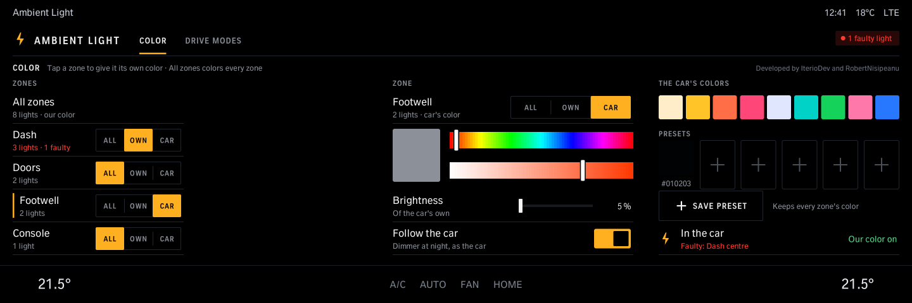
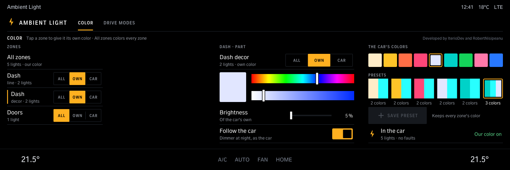
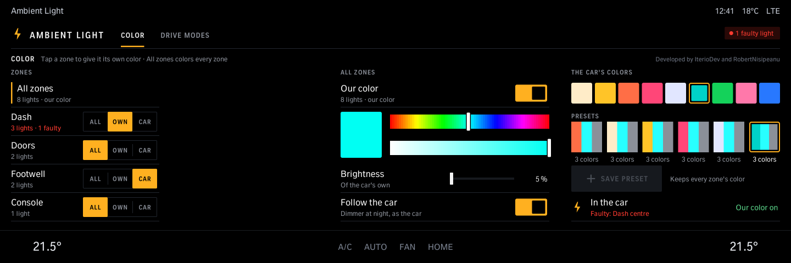
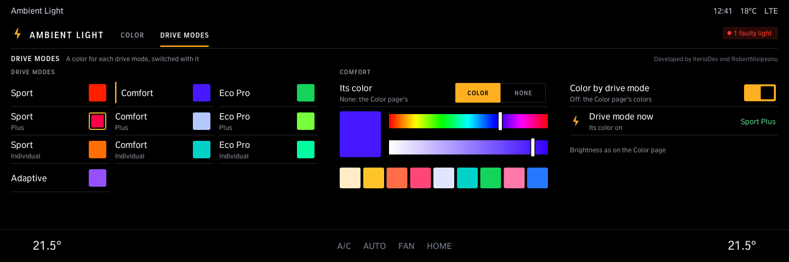
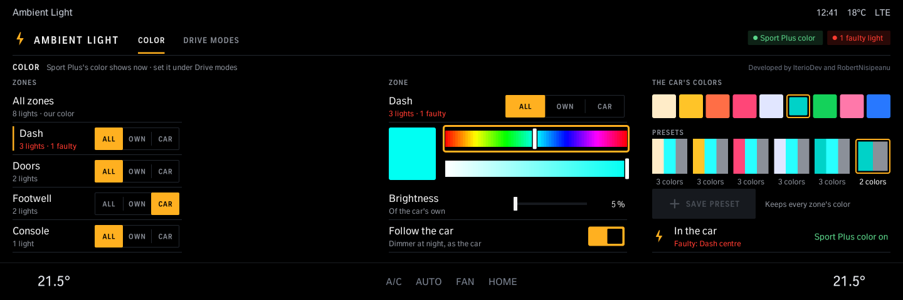
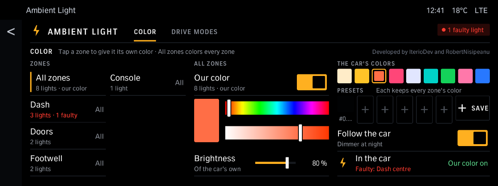
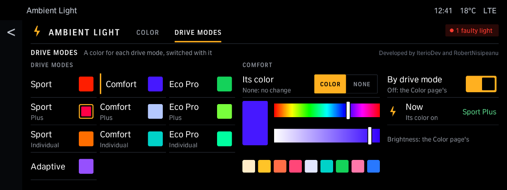

# Ambient Light

Any color on the interior ambient light, not only the car's own presets, on one screen: your car's zones in a list (dash, doors, footwell, console, seats, roof: the ones it has), a color bar for any shade, brightness (or follow the car's, dimmer at night), the car's colors as starting points and six presets of your own that keep every zone's color. Each zone can follow the main color, have its own, or keep the car's. A zone with two kinds of light (an X6's dash: a line above, decor below) shows as two rows, each with its own color. Drive modes: a color for each drive mode (Sport, Comfort, Eco Pro, their Plus and Individual, Adaptive) that the light switches to with the mode. Works while the car's own ambient light is switched on. Needs the Comfort tool (the Store installs it with the app).

Version 1.4.4 · iDrive 7 and 8 · package `iteriodev_ambient` · [all apps and how to install](../../README.md)

> [!NOTE]
> Bowers & Wilkins speaker and tweeter lights are not controllable: they keep the car's own color (set it in the car's menu, or with the car's colors in the app).

> [!NOTE]
> The color route is run on a car (an M4, BDC_G05: custom colors on all eight light modules, Comfort 0.1.3). Comfort 0.1.4 runs on that car and finds its lights and zones. The 1.1.1 screen is not run on a car yet. iDrive 7 (1.2.0): not run on an iDrive 7 car yet. Drive modes (1.3.0): not run on a car yet; Sport Plus is the car's "Sport expert" mode, a guess. The iDrive controller (1.4.0): on an M4 only the first controller states reached the app; 1.4.1 fixes that, not run on a car yet.

## Screens

Screens from the app's offline test against a simulated car, so the values are made up.

### Color

All zones picked: the color bars and the car's colors set the main color.

Drag the color bars; the lights follow (at most four updates a second reach the car).

### Zones

Tap a zone's name to color it with the bars; its All / Own / Car buttons give it the main color, its own, or the car's.

A dash with a line and decor: two rows, each its own color.

### Presets

Save preset keeps the whole look: the main color and every zone's (six at most, the oldest goes). Tap one to bring it all back.

### Drive modes

A color for each drive mode: tap a mode, then set its color with the bars or the car's colors, or None to leave the light as the Color page has it. With *Color by drive mode* on, switching the mode (the car's own drive mode switch) turns every zone to that mode's color; a mode without one goes back to the Color page's colors. The ringed swatch is the mode the car is in now. Brightness stays as on the Color page.

### iDrive controller

For cars without a touchscreen (1.4.2: fixed for iDrive 7, where the controller was given up on too soon; not run on an iDrive 7 car yet): turn the controller and a white ring goes from control to control (the zone list, then the middle, then the car's colors and presets); push it up, down or right to jump that way. Press to tap the ringed control. On a color bar or the brightness slider, press once (the ring turns amber), turn to change it, press again when done. The first turn only shows the ring; touching the screen hides it. Push left or BACK leaves the page as usual.

### iDrive 7

The same page on iDrive 7's smaller screen: each zone shows All / Own / Car as text; tap one, then set it with the buttons in the middle.

