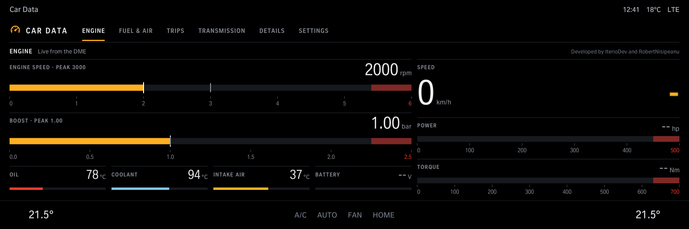
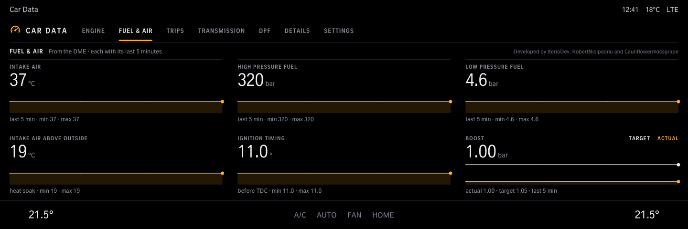
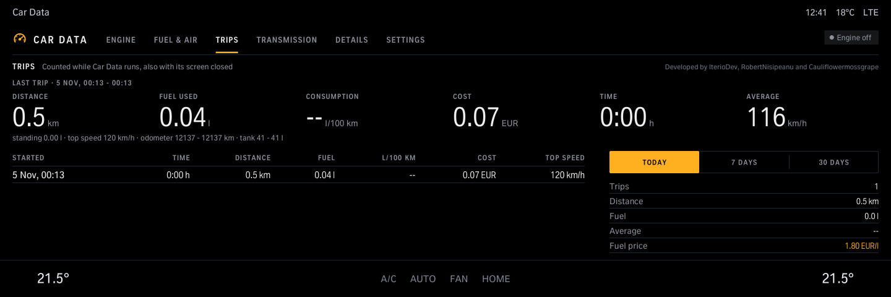
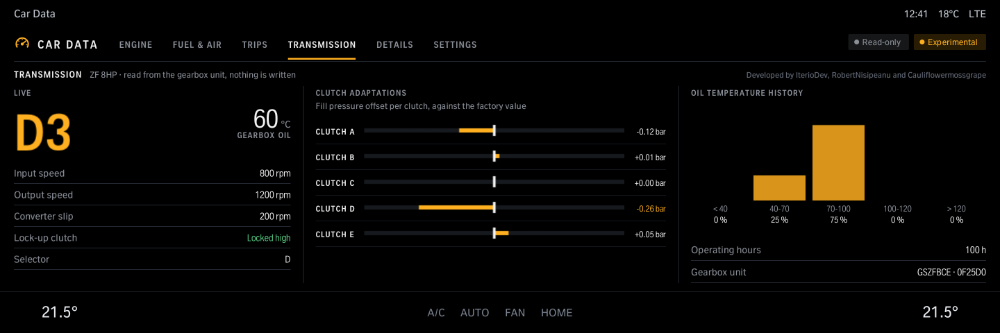
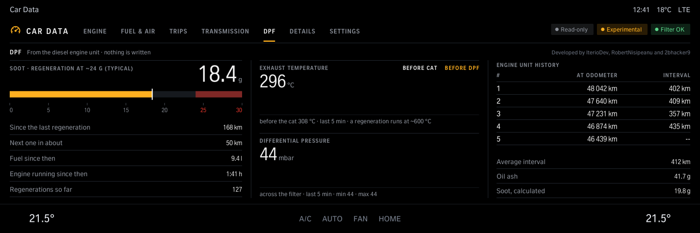
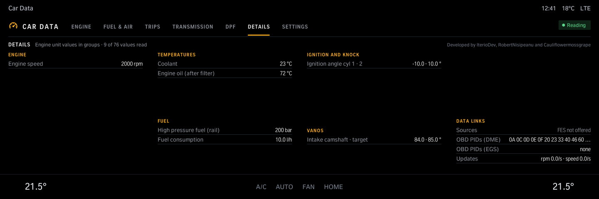
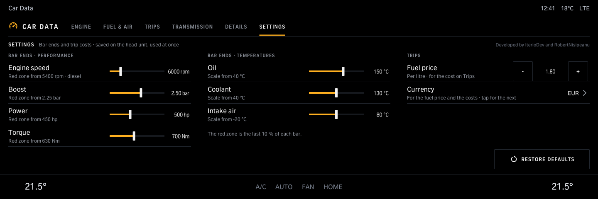

# Car Data

Live engine data on your iDrive 8 screen: engine speed, boost, power and torque with their peaks, oil, coolant and intake temperatures, battery voltage; fuel and air values with their last 5 minutes; a trip computer with costs; gearbox data (ZF 8HP, read-only, experimental); the engine unit's values in groups; on diesel cars a DPF page (soot load, regenerations, exhaust temperatures, read-only, experimental). Bar ends, fuel price and currency are set on the Settings page.

Version 1.4.1 · iDrive 8 only · package `iteriodev_cardash` · [all apps and how to install](../../README.md)

> [!NOTE]
> Version 1.4.1 is not tested on a car yet. Open points: the fuel figure on Trips, whether trips are counted while the screen is closed, Transmission (ZF 8HP variants 0F25D0 and 0F21E0 only) and the DPF page (never run on a diesel).

## Screens

Screens from the app's offline test against a simulated car, so the values are made up. The climate bar along the bottom is the test's stand-in for the car's own.

### Engine

Engine speed, boost, power and torque with their peaks, the speed, and oil, coolant, intake air and battery.

### Fuel & air

Intake air, fuel pressures, ignition timing and boost (target and actual), each with its last 5 minutes.

### Trips

The last trip (distance, fuel, consumption, cost, time, average speed) and the totals for today, 7 or 30 days.

### Transmission

ZF 8HP, read-only and experimental: gear, gearbox oil, speeds, converter slip, clutch adaptations and the oil temperature history.

### DPF (diesel cars)

Read-only and experimental, shown unless the car reports a petrol engine. The soot load against the point where a regeneration starts (learned from this car's regenerations, else a typical 24 g), the distance, fuel and engine time since the last one, an estimate of the km to the next one, the exhaust temperatures and the pressure across the filter with their last 5 minutes, and the engine unit's own record of its last five regenerations. While one runs, the page says so. The idea and the list of values come from 2bhacker9's DPF Monitor (cauliflowermossgrape/idrive7-apps issue #88), checked against BMW's DDE 8.3 description (B47 / B57).

### Details

The engine unit's values in groups.

### Settings

Where each bar turns red, the fuel price and the currency. The currencies run from EUR to TL: with TL a new install's fuel price starts at 75.50 TL/l, the other currencies at 1.80.
