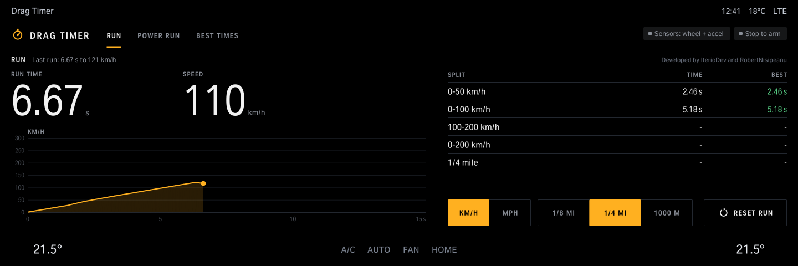
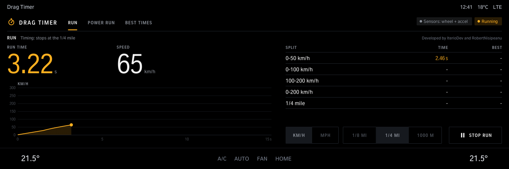
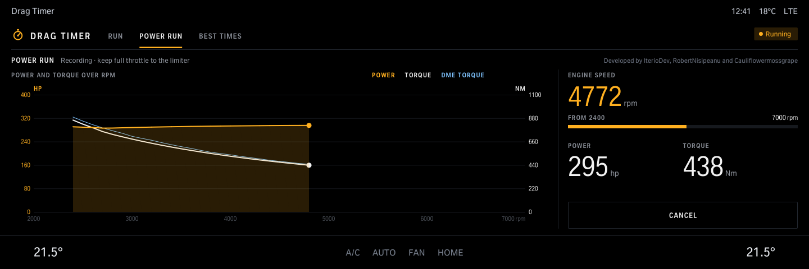
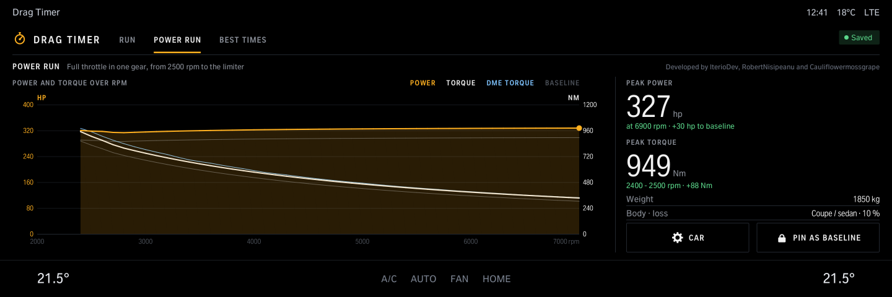
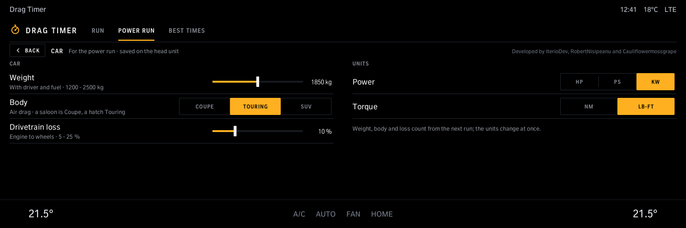
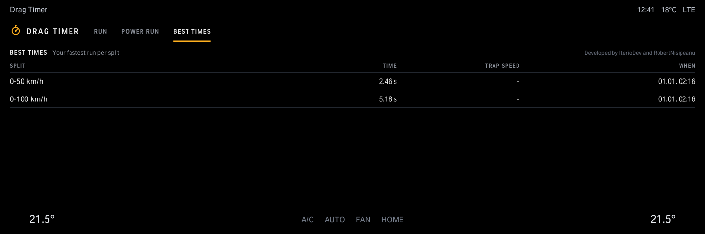

# Drag Timer

Acceleration timer: stand still, launch, and it times the run with splits and a speed-over-time chart, timed from the launch. Power run: floor it in one gear for power and torque over rpm, with a baseline to compare. Keeps your best times; km/h or mph.

Version 1.2.0 · iDrive 8 only · package `iteriodev_draggy` · [all apps and how to install](../../README.md)

> [!NOTE]
> Version 1.2.0 is not tested on a car yet.

## Screens

Screens from the app's offline test against a simulated car, so the values are made up. The climate bar along the bottom is the test's stand-in for the car's own.

### Run

Run time, speed, the splits and the speed-over-time chart. km/h or mph; the run ends at 1/8 mile, 1/4 mile or 1000 m.

### A run being timed

Timing starts at the launch.

### Power run

Full throttle in one gear: power and torque over rpm, recorded live.

### Power run result

Peak power and torque, compared with the baseline. *Pin as baseline* keeps a run to compare the next ones with.

### Car

Weight, body and drivetrain loss for the power figure; hp, PS or kW and Nm or lb-ft.

### Best times

Your fastest time per split.
