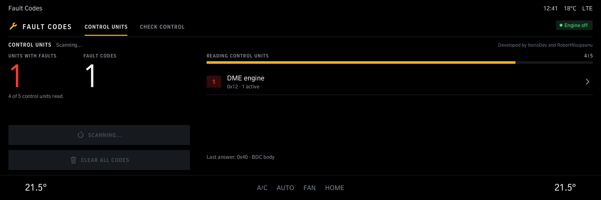
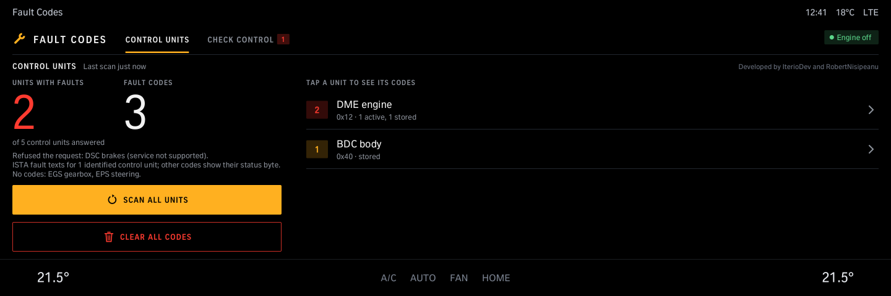
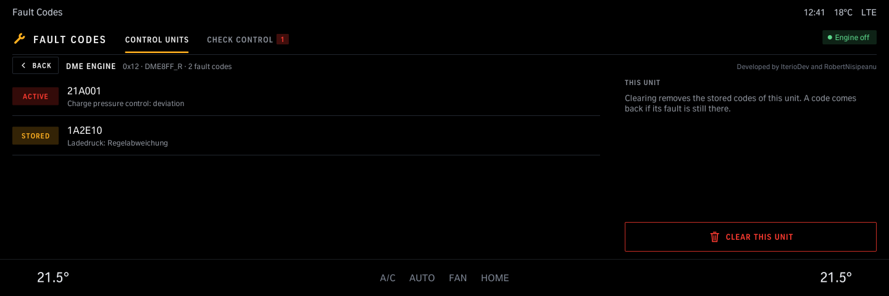
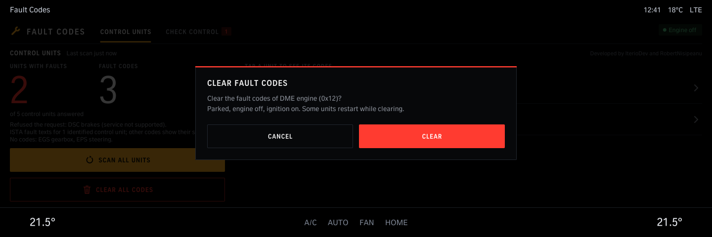
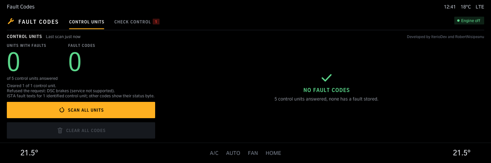
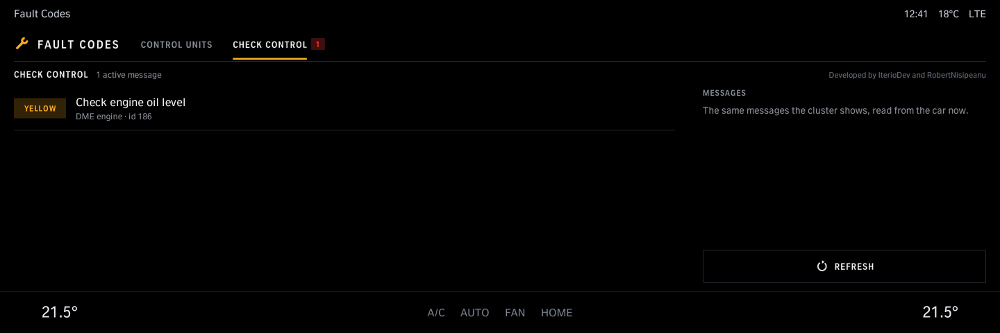

# Fault Codes

Reads the fault memory of every control unit in the car and shows each fault with its text; clears it when you ask. Also lists the car's Check Control messages.

Version 1.2.0 · iDrive 8 only · package `iteriodev_dtcscan` · [all apps and how to install](../../README.md)

> [!NOTE]
> Version 1.2.0 is not tested on a car yet.

## Screens

Screens from the app's offline test against a simulated car, so the values are made up. The climate bar along the bottom is the test's stand-in for the car's own.

### Scanning

*Scan all units* reads the fault memory of every control unit.

### Control units

The units with faults and how many codes; tap a unit for its codes.

### A unit's codes

Each code with its text, active or stored. *Clear this unit* clears only this one.

### Clearing

Asks first. Clear parked, with the engine off and the ignition on.

### After clearing

No fault codes left.

### Check Control

The messages the instrument cluster shows.
