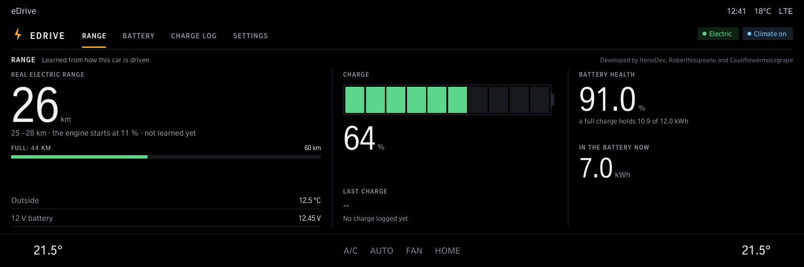
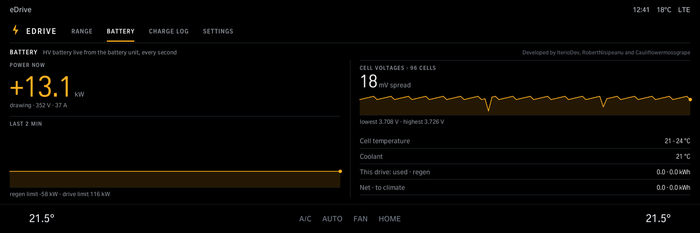
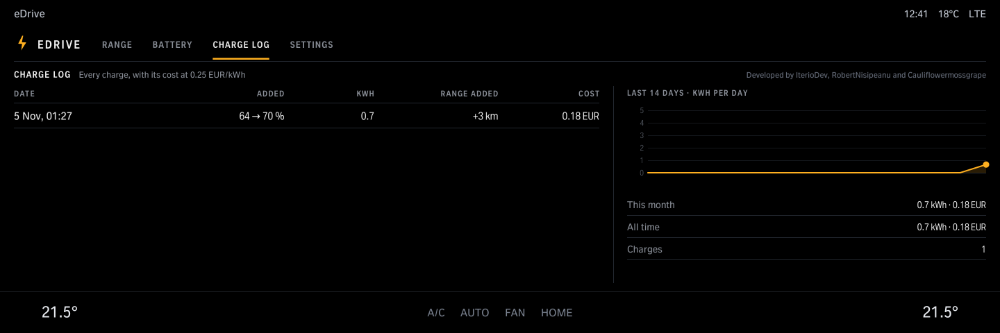
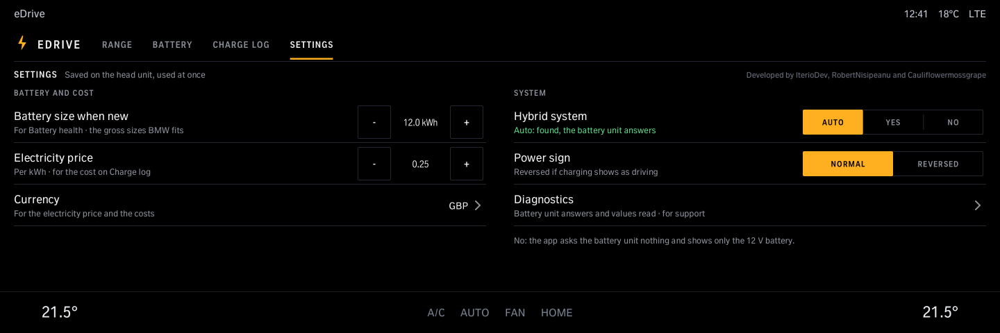
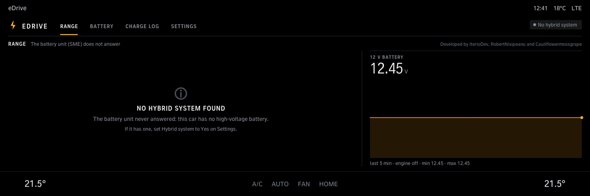
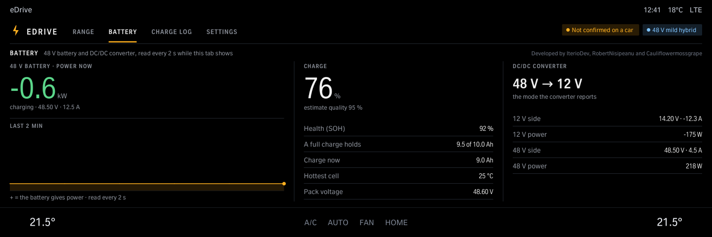

# eDrive

For plug-in hybrids: the real electric range, learned from how the car is driven, the charge level and the battery's health, live power and cell voltages, and a log of the charges with their cost. Read-only. On a car without a high-voltage battery it says so and shows the 12 V battery; on a 48 V mild hybrid also its 48 V battery (charge, health, power) and DC/DC converter. Not tested on a car yet. iDrive 8.

Version 1.1.0 · iDrive 8 only · package `iteriodev_edrive` · [all apps and how to install](../../README.md)

> [!NOTE]
> Version 1.1.0 is not tested on a car yet: not on a plug-in hybrid, not on a 48 V mild hybrid.

## Screens

Screens from the app's offline test against a simulated car, so the values are made up. The climate bar along the bottom is the test's stand-in for the car's own.

### Range

The real electric range, learned from how the car is driven, the charge level, the battery's health and the energy in it.

### Battery

Live power, the cell voltages and their spread, cell temperature, coolant and the energy used on this drive.

### Charge log

Every charge with its kWh and cost, and the last 14 days.

### Settings

Battery size when new, electricity price, currency, hybrid system (Auto / Yes / No), the power sign and Diagnostics.

### Without a hybrid system

A car without a high-voltage battery: the app says so and shows the 12 V battery.

### A 48 V mild hybrid

Its 48 V battery (power, charge, health) and the DC/DC converter (its mode, both sides). The values follow BMW's own descriptions of these units; not yet confirmed on a car. From jezikk82's patch to idrive7-apps.
