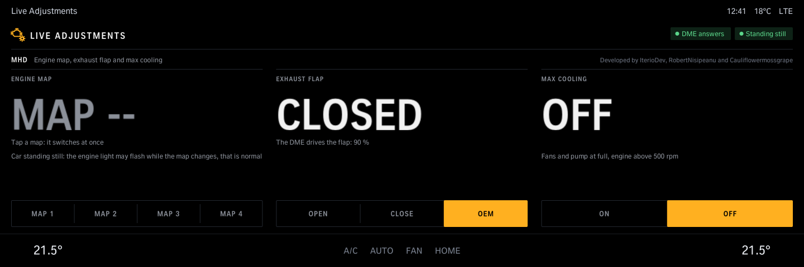
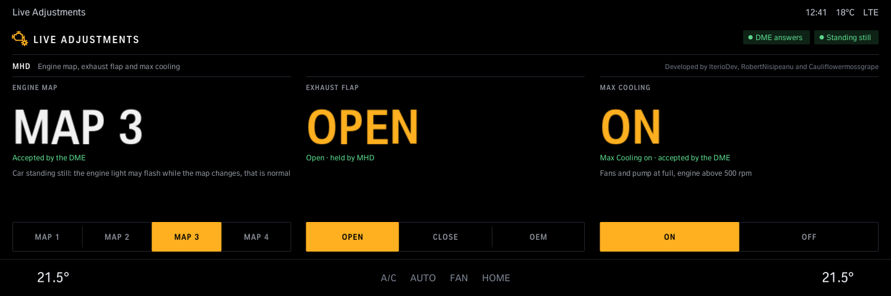
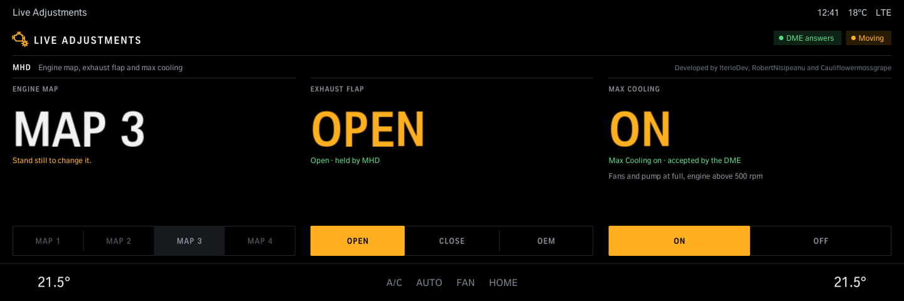
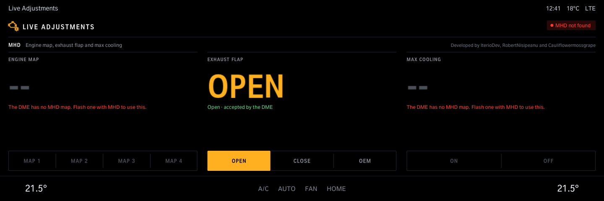

# Live Adjustments

Live adjustments for an MHD-tuned DME: switch engine maps 1-4 with the car standing still, MHD Max Cooling on (engine running) or off, and open or close the exhaust flap (MHD's own flap control, held while driving; without MHD, BMW's DME job, which the DME takes back after about 20 s or when the car moves). Map and cooling show what the DME accepted: MHD has no read-back.

Version 1.1.0 · iDrive 8 only · package `iteriodev_liveadjust` · [all apps and how to install](../../README.md)

> [!NOTE]
> Car-tested: the engine map switch (MHD). Max Cooling, MHD's own flap control and the 1.1.0 screens are not tested on a car yet.

## Screens

Screens from the app's offline test against a simulated car, so the values are made up. The climate bar along the bottom is the test's stand-in for the car's own.

### Opened

No map picked yet, the exhaust flap where the DME has it, Max Cooling off.

### Map, flap and cooling set

Map 3 accepted by the DME, the flap open and held by MHD, Max Cooling on.

### Driving

The map can only be changed standing still; the flap and Max Cooling still work.

### A DME without MHD

Map and Max Cooling are greyed out; the flap works through BMW's own DME job.
