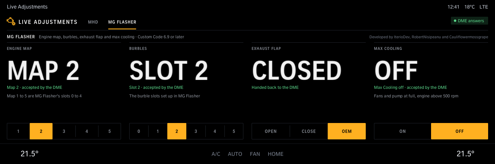
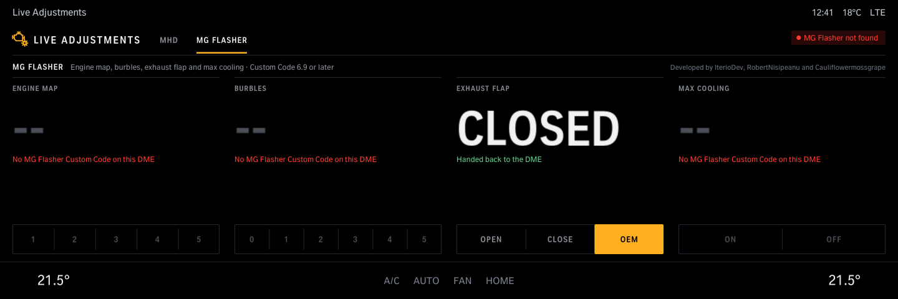

# Live Adjustments

Live adjustments for an MHD- or MG Flasher-tuned DME, one tab per tune: switch engine maps at any time, also while driving (MHD maps 1-4, MG Flasher maps 1-5), MG Flasher burble slots 0-5, Max Cooling on (engine running) or off, and open or close the exhaust flap (on MHD its own flap control, held while driving; otherwise BMW's DME job, which the DME takes back after about 20 s or when the car moves). Shows what the DME accepted: neither tune has a read-back here.

Version 1.2.0 · iDrive 8 only · package `iteriodev_liveadjust` · [all apps and how to install](../../README.md)

> [!NOTE]
> Car-tested: the engine map switch standing still (MHD). Switching while driving (1.1.1), Max Cooling, MHD's own flap control, the 1.1.x screens and the whole MG Flasher tab (1.2.0) are not tested on a car yet.

The MG Flasher tab (Custom Code 6.9 or later) sends the requests MG Flasher's own Android app sends, as found by mlurker's [bmw-idrive7-advokat](https://github.com/mlurker/bmw-idrive7-advokat) (MIT): `2E 69 45` map slot, `2E 69 46` burble slot, `2E 69 47` Max Cooling, each with the value and a checksum. Changing tabs sends nothing; the tab you picked last opens next time.

## Screens

Screens from the app's offline test against a simulated car, so the values are made up. The climate bar along the bottom is the test's stand-in for the car's own.

### Opened

No map picked yet, the exhaust flap where the DME has it, Max Cooling off.

### Map, flap and cooling set

Map 3 accepted by the DME, the flap open and held by MHD, Max Cooling on. All three work while driving too; Max Cooling On needs the engine running (over 500 rpm).

### A DME without MHD

Map and Max Cooling are greyed out; the flap works through BMW's own DME job.

### MG Flasher

Map 2 and burble slot 2 accepted by the DME, the flap handed back to the DME (on this tab always BMW's own DME job). Maps and burbles work while driving too; Max Cooling On needs the engine running (over 500 rpm).

### A DME without MG Flasher's Custom Code

Map, burbles and Max Cooling are greyed out until the app is opened again; the flap still works.
