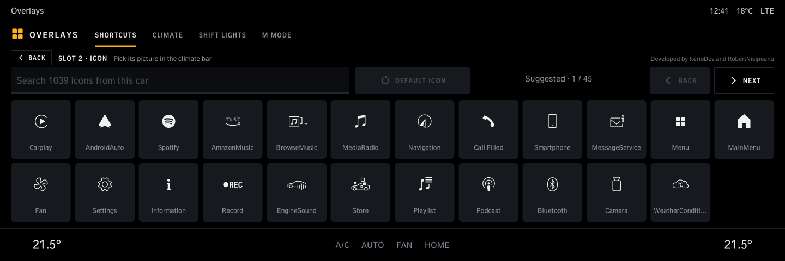
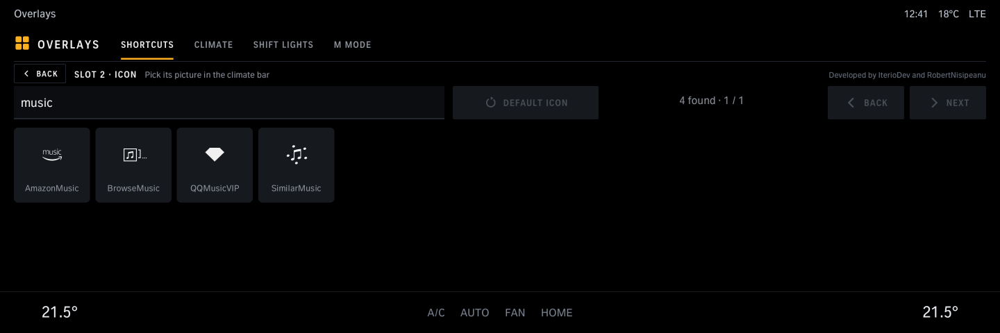
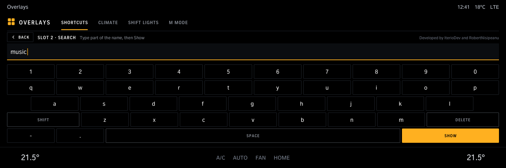
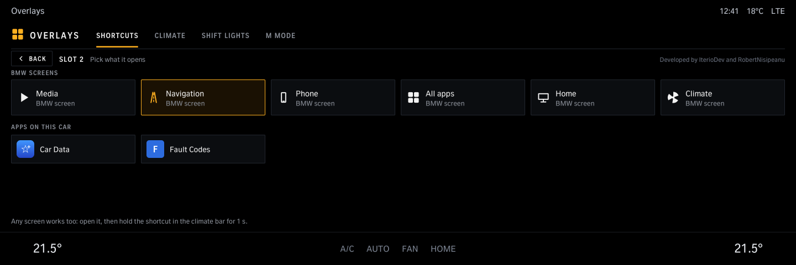
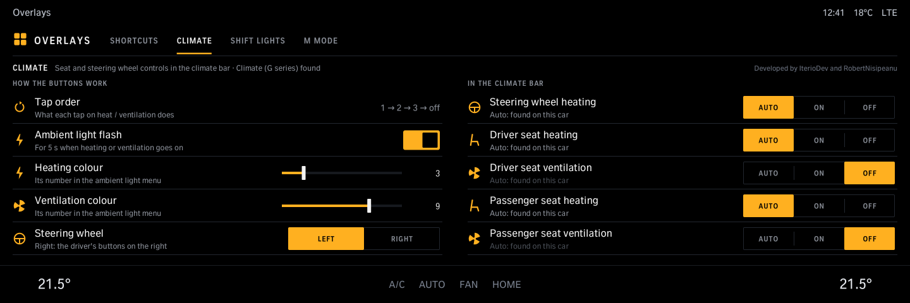
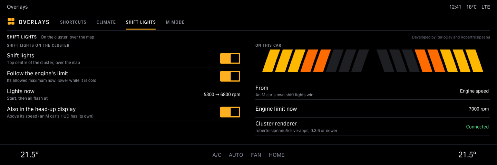

# Overlays

Set up the Overlays strip in the climate bar: what each of the four shortcuts opens (BMW screens or apps) and its icon (any of the head unit's own, with a search), the seat heating / ventilation and steering wheel buttons, the tap order, shift lights on the instrument cluster for cars without their own, not M cars (needs Cluster renderer from robertnisipeanu/idrive-apps), and on M cars which M Mode M1 / M2 switch to. Needs the Overlays tool from the same source.

Version 1.4.0 · iDrive 8 only · package `iteriodev_overlays` · [all apps and how to install](../../README.md)

> [!NOTE]
> The strip in the climate bar is car-tested (G82); the app's pages are not yet, nor the icon picker (1.4.0, tool 0.5.0). Needs the Overlays tool (the Store installs it with the app).

## Screens

Screens from the app's offline test against a simulated car, so the values are made up. The climate bar along the bottom is the test's stand-in for the car's own.

### Shortcuts

The four slots next to *CLIMATE MENU*; tap one to change what it opens or its icon.

### Icons

Any of the head unit's own icons for a shortcut, 24 a page; the first page suggests the usual ones. The Overlays tool reads them from your head unit's firmware, so nothing of BMW's is in the package. *Default icon* gives the shortcut its own picture back, and so does saving another screen into it.

Tap the search box, type part of the name, then *Show*.

### Picking a slot

BMW screens or the apps on this car.

### Climate

Tap order, the ambient light flash and its colours, the steering wheel's side (*Right* for a right-hand drive car: the driver's buttons on the right), and which seat and steering wheel buttons the strip shows.

### Shift lights

On the instrument cluster for cars without their own (an M car shows its own, so these are hidden there): start and flash rpm (or the engine's own limit), also in the head-up display. Needs Cluster renderer 0.3.6 or newer.

### M Mode

M cars: the M Mode that M1, M2 and off switch to, and *Start in M SPORT*.
