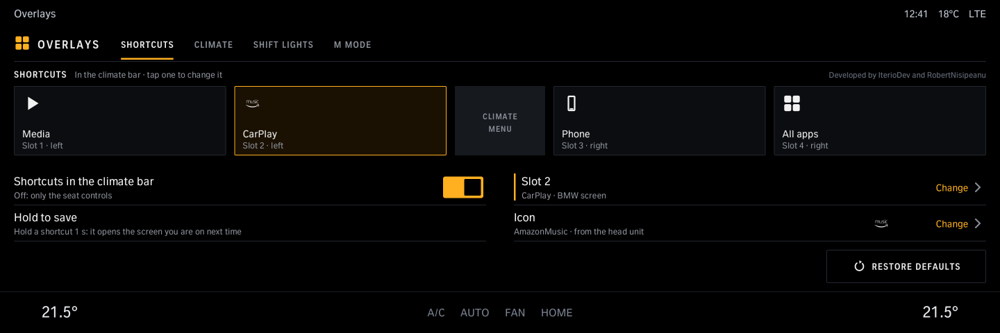
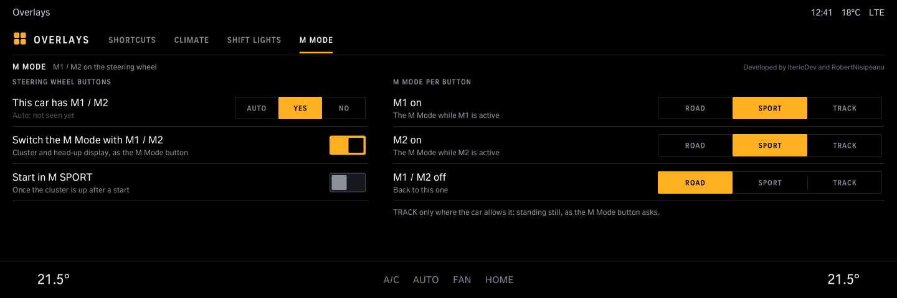

# Overlays

Set up the Overlays strip in the climate bar: what each of the four shortcuts opens (BMW screens or apps), the seat heating / ventilation and steering wheel buttons, the tap order, shift lights on the instrument cluster for cars without their own, not M cars (needs Cluster renderer from robertnisipeanu/idrive-apps), and on M cars which M Mode M1 / M2 switch to. Needs the Overlays tool from the same source.

Version 1.2.2 · iDrive 8 only · package `iteriodev_overlays` · [all apps and how to install](../../README.md)

> [!NOTE]
> The strip in the climate bar is car-tested (G82); the app's pages are not yet. Needs the Overlays tool (the Store installs it with the app).

## Screens

Screens from the app's offline test against a simulated car, so the values are made up. The climate bar along the bottom is the test's stand-in for the car's own.

### Shortcuts

The four slots next to *CLIMATE MENU*; tap one to change it.

### Picking a slot

BMW screens or the apps on this car.

### Climate

Tap order, the ambient light flash and its colours, and which seat and steering wheel buttons the strip shows.

### Shift lights

On the instrument cluster for cars without their own (an M car shows its own, so these are hidden there): start and flash rpm (or the engine's own limit), also in the head-up display. Needs Cluster renderer 0.3.6 or newer.

### M Mode

M cars: the M Mode that M1, M2 and off switch to, and *Start in M SPORT*.
