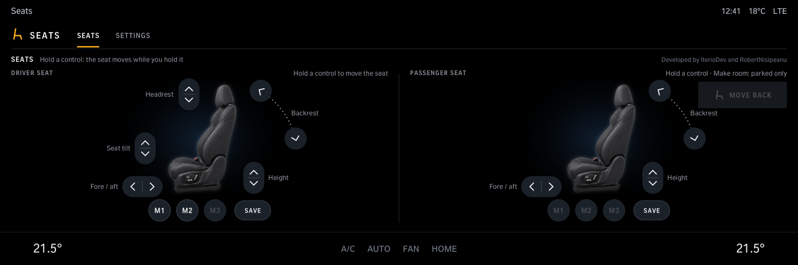
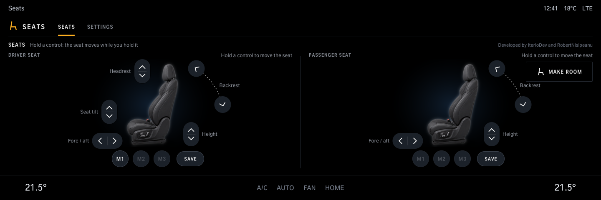
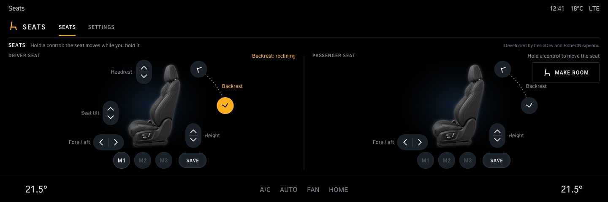
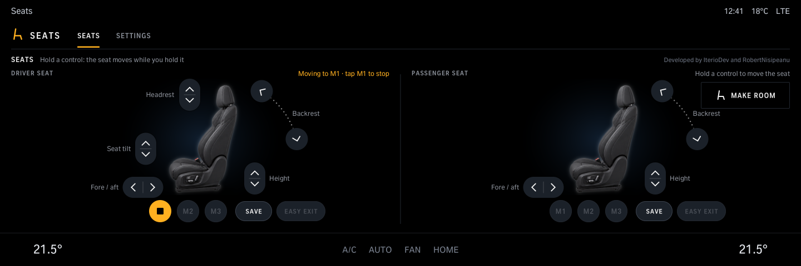
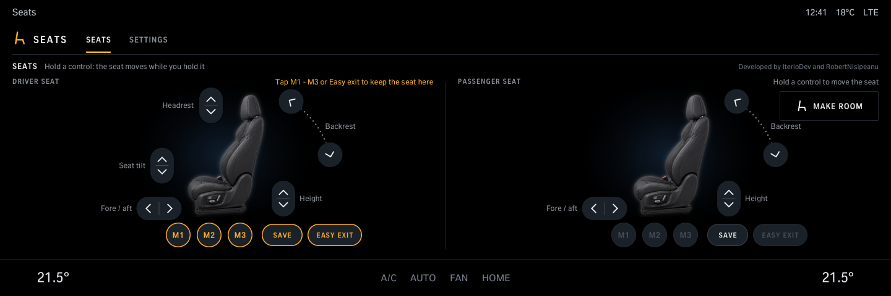
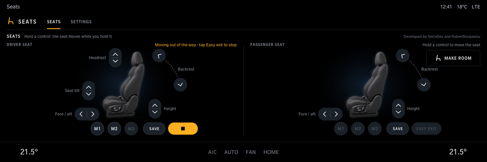
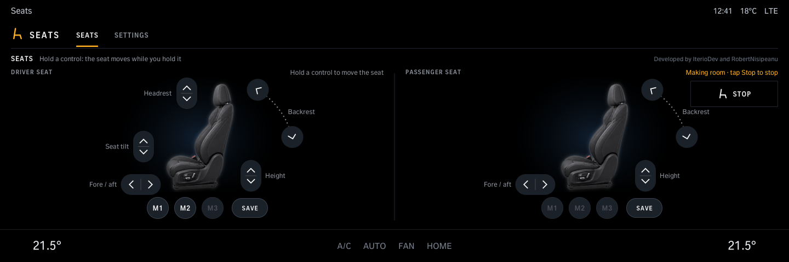
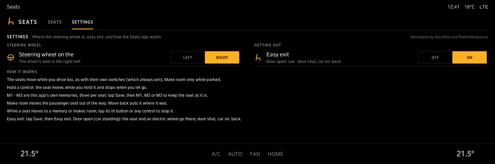
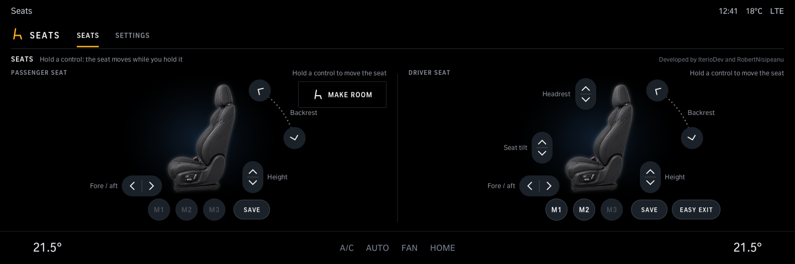
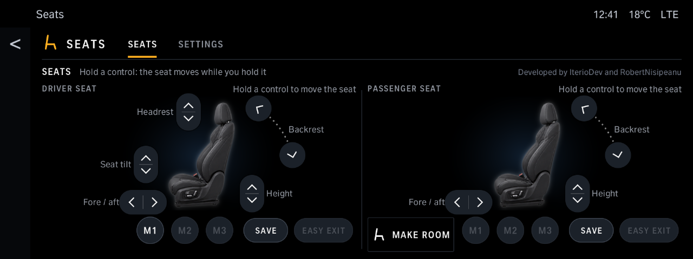

# Seats

Move the driver and passenger seats from the central display, also while driving (as with the seats' own switches, for a passenger who can't reach theirs), both on one page: each seat seen from the side with its controls round it (fore / aft, height, backrest, tilt and headrest, while you hold them), three memories per seat under it (for cars without memory buttons too), the Gentleman button (parked only) that moves the passenger seat out of the way and back, and Easy exit: the driver seat (and an electric steering column) moves to your own getting-out position when the driver door opens with the car standing, and back once the door is shut with the car on. The seat's own switches always win. Needs the Comfort tool (the Store installs it with the app).

Version 1.4.1 · iDrive 7 and 8 · package `iteriodev_seats` · [all apps and how to install](../../README.md)

> [!NOTE]
> Run on a car (an M4, seat modules FAS_G11 / BFS_G11): hold-to-move and memory recall work, parked. Not run on a car yet: the 1.1.0 page, Make room, and moving while driving (1.1.1; whether the seat modules take it at speed is not known yet). iDrive 7 (1.2.0): not run on an iDrive 7 car yet. Easy exit and the electric steering column (1.4.0): not run on a car yet.

### While driving

Everything works but Make room, which needs the car parked.

## Screens

Screens from the app's offline test against a simulated car, so the values are made up.

### Both seats

Hold a control: the seat moves while you hold it. Only the controls a seat has are shown.

### Moving

The control held turns amber; the line at the top says what moves.

### Memories

M1 - M3: tap to recall. While the seat moves to it, the button is lit: tap it (or any control) to stop.

Save, then M1, M2 or M3 keeps the seat as it is. On a car with an electric steering column, the driver's memories keep the wheel's place too.

### Easy exit

Save, then Easy exit keeps your getting-out position (the driver seat, and an electric steering column). With the car standing (under 2 km/h, the engine may run), the driver door opening moves the column, then the seat there; the driver door shut with the ignition or the engine on (whichever comes last) puts both back where you sat. Tap Easy exit to go there by hand, or to stop a move. The column moves only while the car stands and stops at its own soft end stops. Settings has an *Easy exit* Off / On switch.

### Make room

Moves the passenger seat all the way forward and tips the backrest; the button shows Stop while it runs, then Move back puts it where it was.

### Right-hand drive

Settings, *Steering wheel on the Right*: the driver's seat moves to the right half, the passenger's (with Make room) to the left.

### iDrive 7

The same page on iDrive 7's smaller screen; Make room sits bottom left of the passenger's half.
