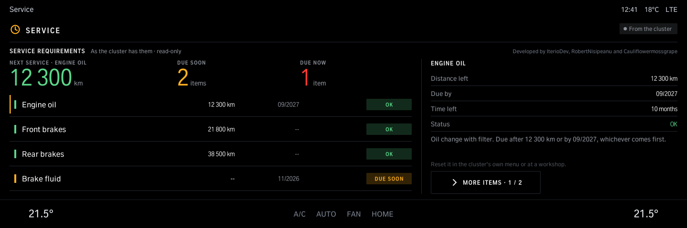
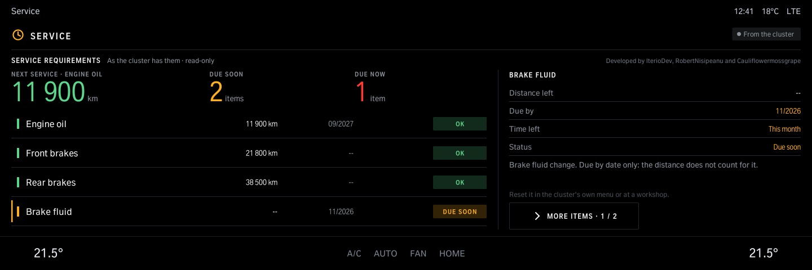
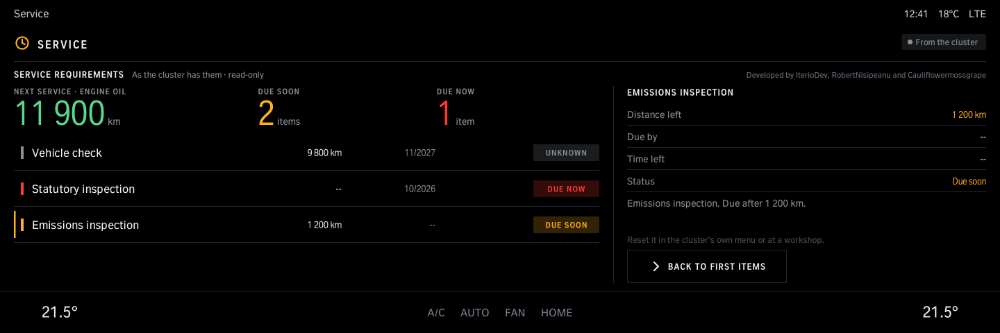
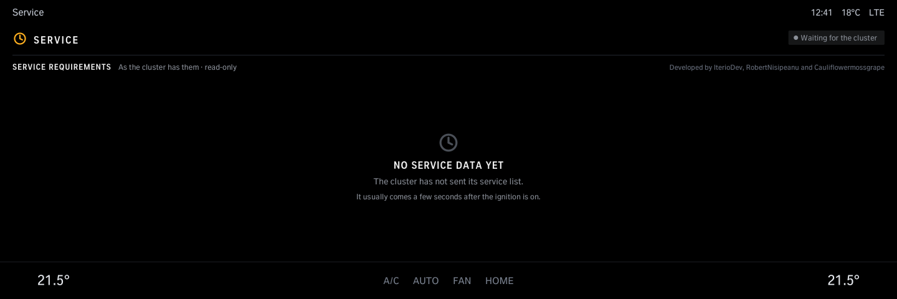

# Service

The car's service requirements as the instrument cluster has them: engine oil, brakes, brake fluid, vehicle check and inspections, each with the distance and the date left and whether it is due. Read-only: a service is reset in the cluster's own menu or at a workshop. iDrive 8.

Version 1.0.0 · iDrive 8 only · package `iteriodev_service` · [all apps and how to install](../../README.md)

> [!NOTE]
> Version 1.0.0 is not tested on a car yet.

## Screens

Screens from the app's offline test against a simulated car, so the values are made up. The climate bar along the bottom is the test's stand-in for the car's own.

### Service requirements

The next service, the items due soon and due now, each with the distance and date left.

### An item

Tap an item for what it is and when it is due.

### More items

The next page of items.

### Waiting for the cluster

Before the cluster has sent its list (a few seconds after the ignition is on).
