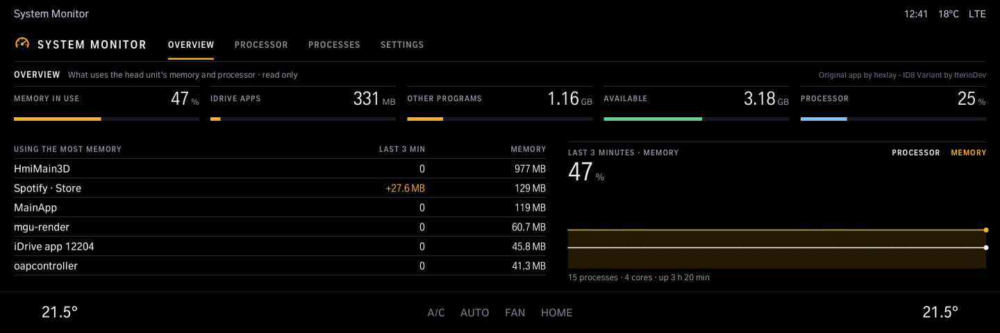
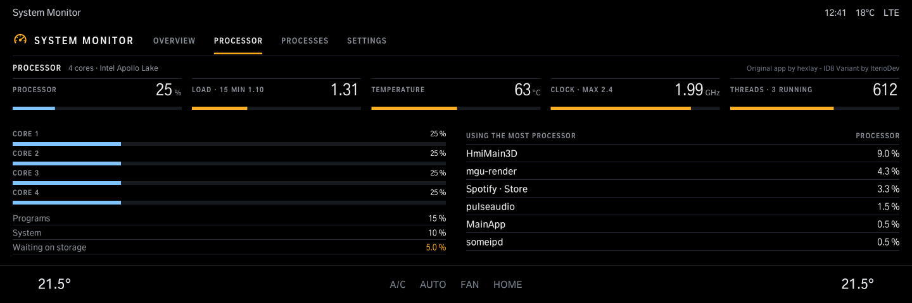
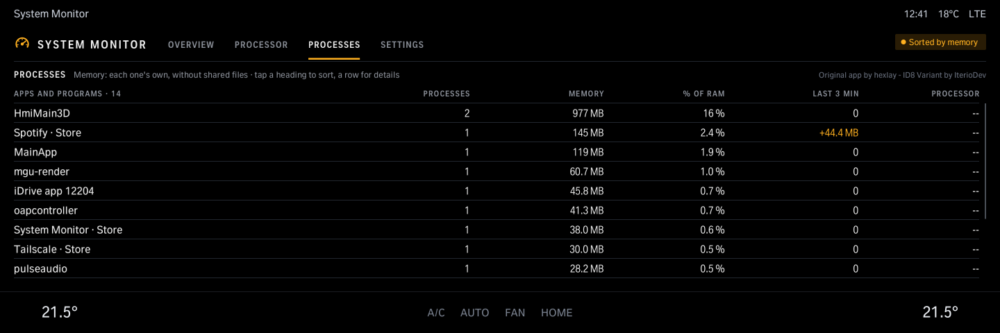
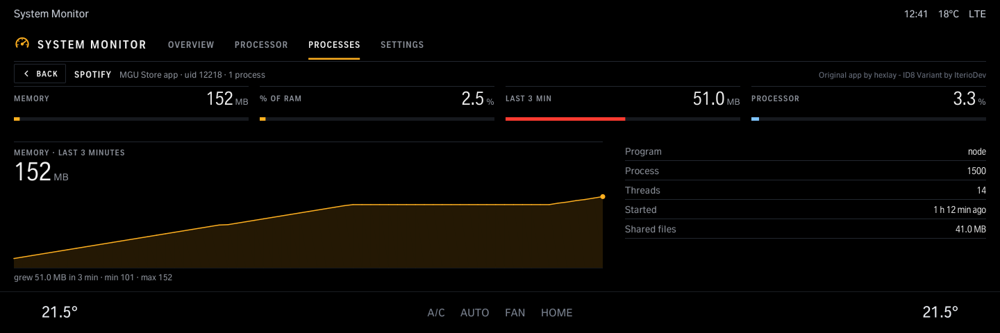
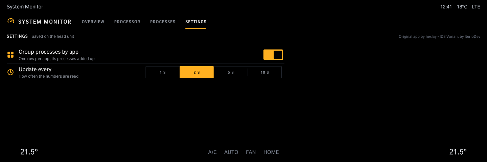

# System Monitor

What uses the head unit's memory and processor, like a computer's activity monitor: free memory and a live history, every app and program with its own memory and how much it grew in the last 3 minutes (so a leak stands out), and the processor per core, its load, temperature and clock. Read-only: it only reads `/proc` and `/sys` while it is on screen, needs no car signals or internet, and can't stop or change anything. iDrive 8.

Original app by hexlay ([hexlay/idrive7-system-monitor](https://github.com/hexlay/idrive7-system-monitor), iDrive 7) - ID8 Variant by IterioDev: a fresh remake in the Telemetry design.

Version 1.0.0 · iDrive 8 only · package `iteriodev_sysmonitor` · [all apps and how to install](../../README.md)

> [!NOTE]
> Version 1.0.0 is not tested on a car yet. Whether the head unit lets an app see the other apps' processes and names,
> and which temperature sensor it has, shows only on a car: hidden processes are left out (with a note), a missing
> sensor shows "--".

## Screens

Screens from the app's offline test against sample data, so the values are made up. The climate bar along the bottom is the test's stand-in for the car's own.

### Overview

Memory in use, iDrive apps, other programs, what is available and the processor; the apps and programs using the most memory with their growth over the last 3 minutes; memory and processor over the last 3 minutes.

### Processor

How busy the processor is, its load, temperature, clock and threads, each core, what the time went to, and what keeps it busy.

### Processes

Every app and program with its processes, own memory (without shared files), share of RAM, growth over the last 3 minutes and processor use. Tap a heading to sort by it (again: the other way round), a row for its details; drag to scroll.

### Details

One app or program: its memory over the last 3 minutes and what it is.

### Settings

Group processes by app (one row per app, its processes added up) and how often the numbers are read.
