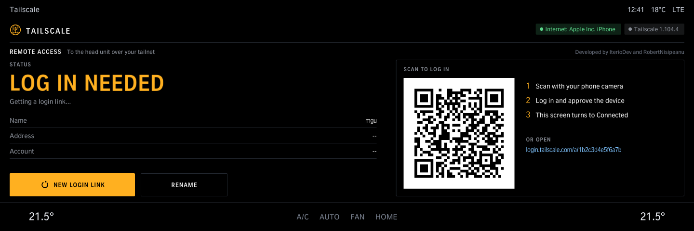
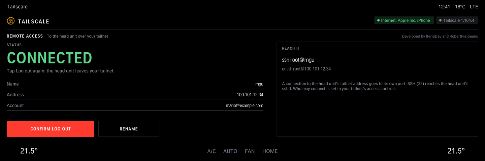
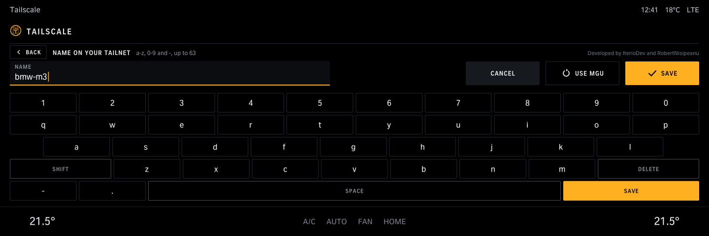
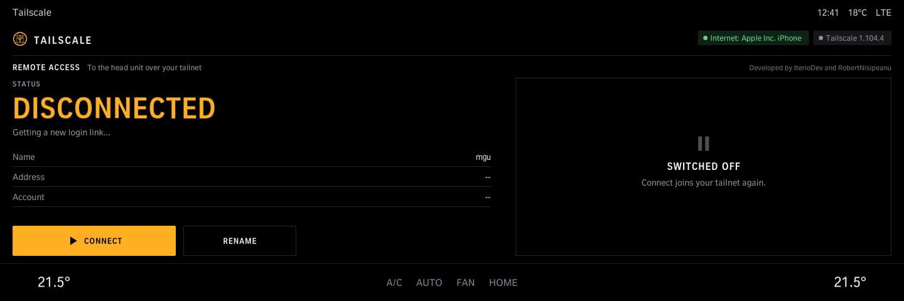
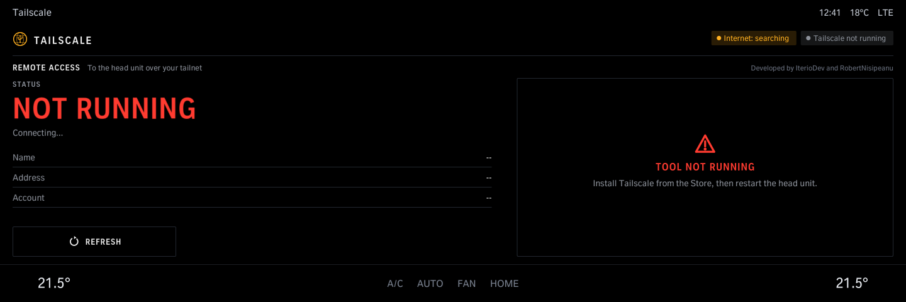

# Tailscale

Log the head unit in to your tailnet without a computer: shows Tailscale's state, the login link as a QR code to scan with your phone, the head unit's tailnet name and address, Rename (default mgu) and Log out. Needs the Tailscale tool from the same source.

Version 1.1.0 · iDrive 8 only · package `iteriodev_tailscale` · [all apps and how to install](../../README.md)

> [!NOTE]
> Version 1.1.0 is not tested on a car yet. Needs the Tailscale tool (the Store installs it with the app).

## Screens

Screens from the app's offline test against a simulated car, so the values are made up. The climate bar along the bottom is the test's stand-in for the car's own.

### Log in

Scan the QR code with your phone and approve the device; the screen turns to *Connected*.

### Connected

The head unit's tailnet name, address and account. *Log out* asks for a second tap.

### Rename

The name on your tailnet (a-z, 0-9 and -; default `mgu`).

### Disconnected

*Connect* joins your tailnet again.

### Tool not running

Install the Tailscale tool from the Store, then restart the head unit.
