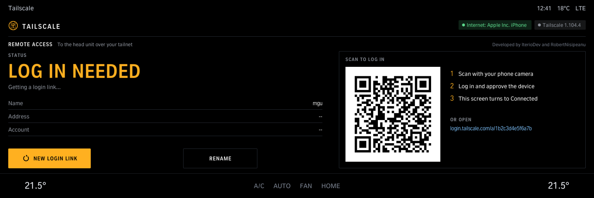
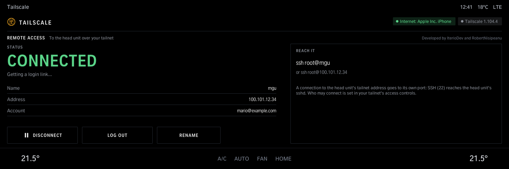
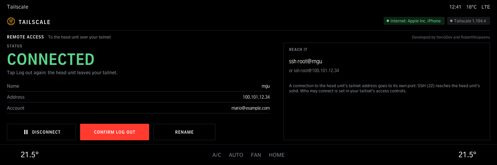
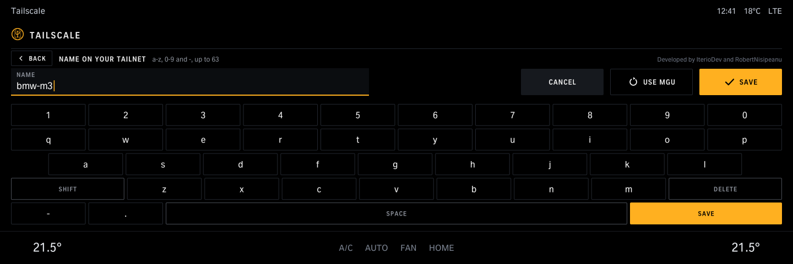
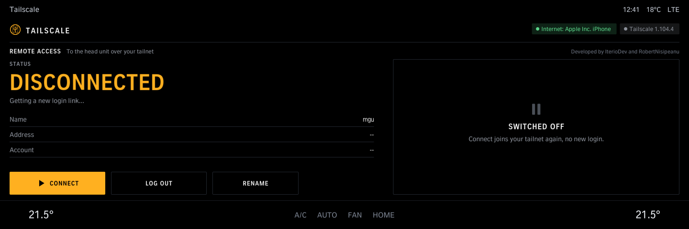
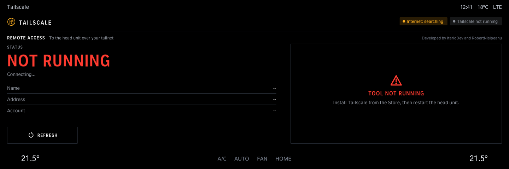

# Tailscale

Log the head unit in to your tailnet without a computer: shows Tailscale's state, the login link as a QR code to scan with your phone, the head unit's tailnet name and address, Rename (default mgu), Disconnect / Connect (switched off, still logged in) and Log out. Works with the iDrive controller. Needs the Tailscale tool from the same source.

Version 1.2.1 · iDrive 7 and 8 · package `iteriodev_tailscale` · [all apps and how to install](../../README.md)

> [!NOTE]
> Logging in and connecting work on an iDrive 7 car (MGU18, issue #51). 1.2.0's Disconnect and the iDrive controller are
> not car-tested yet. Needs the Tailscale tool (the Store installs it with the app).

## Screens

Screens from the app's offline test against a simulated car, so the values are made up. The climate bar along the bottom is the test's stand-in for the car's own.

### Log in

Scan the QR code with your phone and approve the device; the screen turns to *Connected*.

### Connected

The head unit's tailnet name, address and account. *Disconnect* (1.2.0) switches Tailscale off and keeps you logged
in, as `tailscale down`. *Log out* asks for a second tap:

### Rename

The name on your tailnet (a-z, 0-9 and -; default `mgu`).

### Disconnected

*Connect* joins your tailnet again, without a new login. *Log out* is here too.

### iDrive controller

For cars without a touchscreen (1.2.0): turn the controller and a white ring goes from button to button; push it up, down
or right to jump that way; press to tap the ringed button. On *Rename* every key of the keyboard is a stop. Push left or
BACK leaves the page as usual.

### Tool not running

Install the Tailscale tool from the Store, then restart the head unit.
