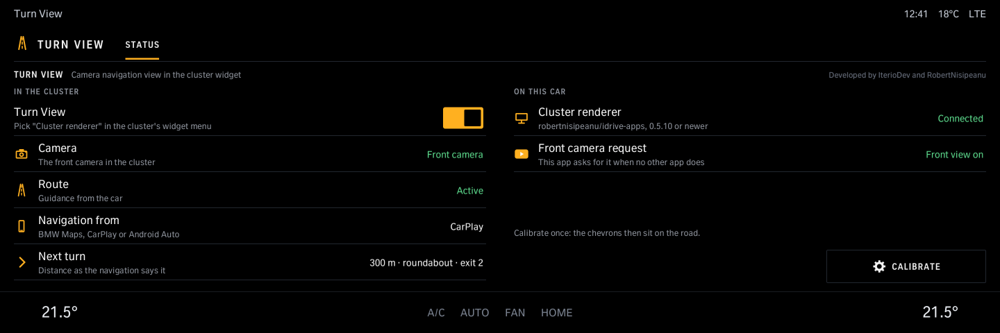
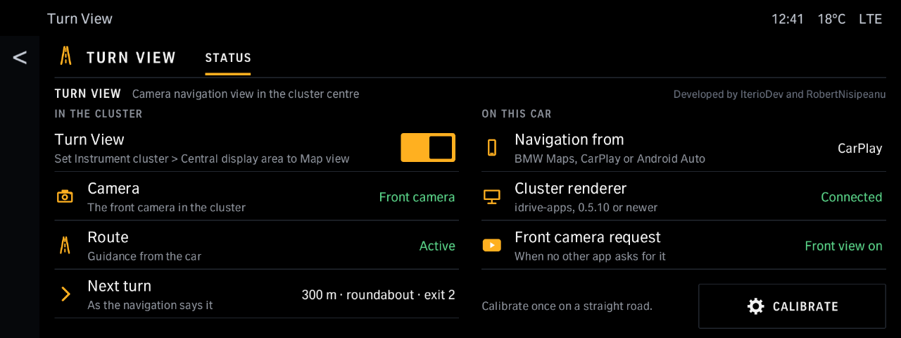
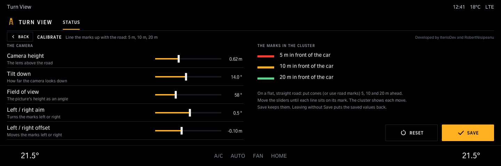
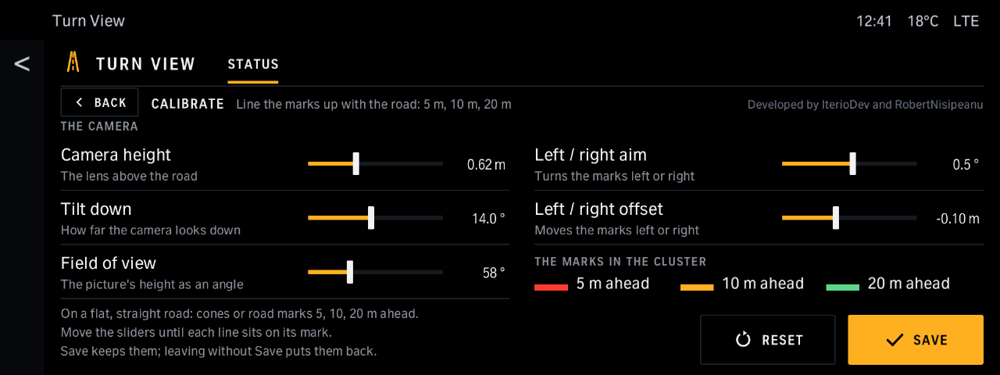

# Turn View

The front camera in the instrument cluster, with a turn card (arrow and distance) and blue chevrons on the road that
bend into the next turn while a route is running. Navigation comes from BMW Maps, CarPlay or Android Auto. Without a
route the cluster shows the front camera alone (1.4.0). No coding needed. The app shows the status and calibrates the
chevrons.

**iDrive 8:** pick **Turn View AR** in the cluster's widget menu (from the car's next start after installing).

**iDrive 7 (1.4.0, tool 0.6.0):** set **Instrument cluster > Central display area** to **Map view**. While Turn View is
on, the camera takes the cluster's central map area, where Waze on cluster draws its map. Waze's map is hidden while
Turn View shows and comes back as soon as Turn View is switched off. The app has its own iDrive 7 screens.

**Needs a front camera:** cars with the 360 cameras (Surround View) or front + rear cameras. When the camera unit
does not give the front camera alone, Turn View asks for front + rear, then all cameras, and shows the front camera
from those. Only a camera unit that gives the rear camera and never the front makes the iDrive 8 widget show *No front
camera* and nothing else. Turn View does not need Drive Recorder: it receives the camera itself.

Version 1.4.0 (tool `iteriodev-turnview` 0.6.0) · iDrive 7 + iDrive 8 · package `iteriodev_turnview` ·
[all apps and how to install](../../README.md)

> [!NOTE]
> Car-tested on iDrive 8 (M4, Apple Maps over CarPlay): the camera and the turn card in the cluster widget. Waze sends
> no turns to the car (route summary only), so with Waze the camera shows without a turn. BMW Maps and Android Auto
> are not car-tested yet, nor are cars with front + rear cameras only (no 360). **iDrive 7 is not car-tested yet**,
> nor is the camera without a route (1.4.0).

Needs Cluster renderer (`cluster-render`, robertnisipeanu/idrive-apps) 0.5.10 or newer. On iDrive 8, after every
update of the Turn View tool, pick the widget again in the cluster menu.

## Screens

Screens from the app's offline test against a simulated car, so the values are made up.

### Status

What the cluster shows: the camera, the route, where the navigation comes from and the next turn.

The same on iDrive 7, with its own layout.

### Calibrate

Camera height, tilt, field of view, aim and offset, with marks at 5, 10 and 20 m: move the sliders until the marks
lie on the road at those distances.
