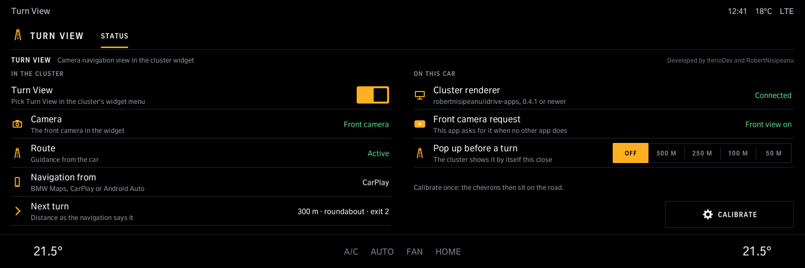
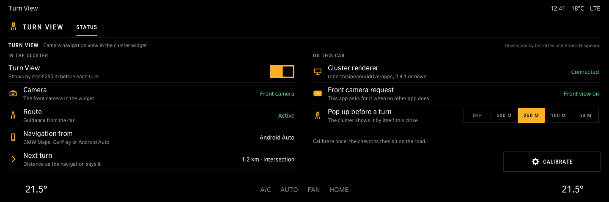
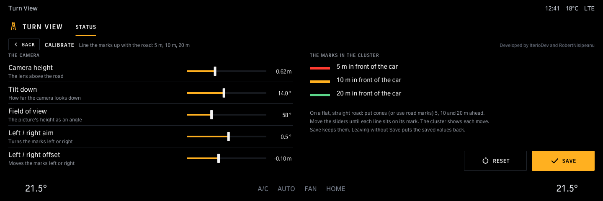

# Turn View

The front camera in the instrument cluster's widget while a route is running, with a turn card (arrow and distance)
and blue chevrons on the road that bend into the next turn. Navigation comes from BMW Maps, CarPlay or Android Auto.
No coding needed: pick Turn View in the cluster's widget menu, or let it pop up by itself near each turn (below).
The app shows the status and calibrates the chevrons.

**Pop-up (1.2.0):** *Pop up before a turn* in the app: *Off* (the widget menu, as before) or 500, 250, 100 or 50 m.
With a distance set, the cluster shows Turn View by itself from that far before each turn, through the turn, and
closes it after; it is not in the widget menu then. The app keeps the front camera asked for the whole route, so the
picture is there when it pops up.

**Smoother camera (1.2.0, tool 0.3.0):** 20 pictures a second instead of 10, at a lower resolution, for the same
load on the head unit.

**Needs a front camera:** cars with the 360 cameras (Surround View) or front + rear cameras. When the camera unit
does not give the front camera alone, Turn View asks for front + rear, then all cameras, and shows the front camera
from those. Only a camera unit that gives the rear camera and never the front makes the widget show *No front camera*
and nothing else; anything else shows *No camera* until the next route. 1.1.0 showed *No front camera* on some cars
that have the cameras: 1.1.1 (tool 0.2.1) drops that and checks again.

Version 1.2.0 (tool `iteriodev-turnview` 0.3.0) · iDrive 8 only · package `iteriodev_turnview` ·
[all apps and how to install](../../README.md)

> [!NOTE]
> Car-tested (2026-11-07, M4, Apple Maps over CarPlay): the camera and the turn card in the cluster widget. The
> chevrons' look and the head unit's load are still being tuned. Waze sends no turns to the car (route summary only),
> so with Waze the widget shows the camera's notice without a turn. BMW Maps and Android Auto are not car-tested yet, nor are cars with front + rear cameras only (no 360). The pop-up and the 20 fps camera (1.2.0) are not car-tested yet.

Needs Cluster renderer (`cluster-render`, robertnisipeanu/idrive-apps) 0.4.1 or newer (the pop-up). The cluster's widget menu
lists it under that name. After every update of the Turn View tool, pick the widget again in the cluster menu.

## Screens

Screens from the app's offline test against a simulated car, so the values are made up.

### Status

What the cluster widget shows: the camera, the route, where the navigation comes from and the next turn.

### Pop-up

*Pop up before a turn* set to 250 m: the cluster shows Turn View by itself 250 m before each turn.

### Calibrate

Camera height, tilt, field of view, aim and offset, with marks at 5, 10 and 20 m: move the sliders until the marks
lie on the road at those distances.
