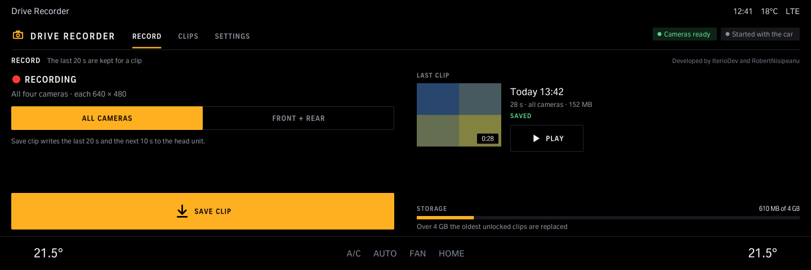
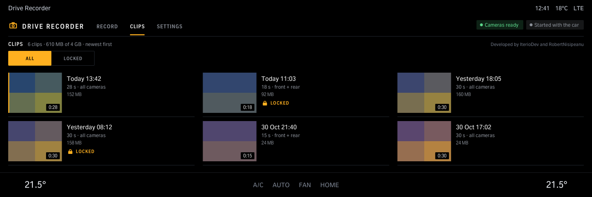
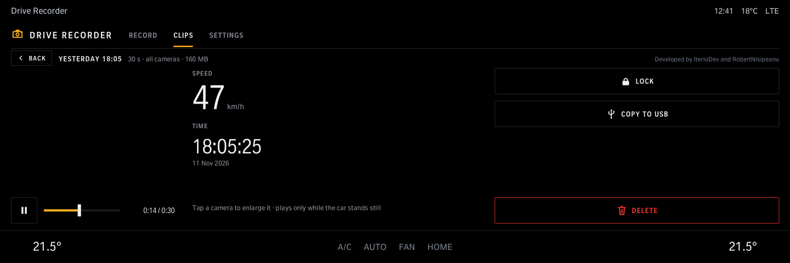
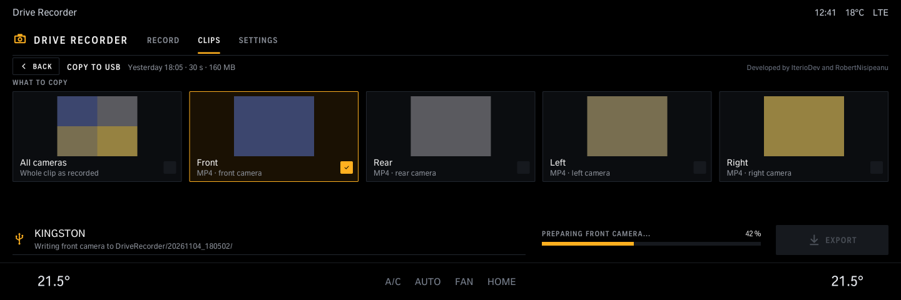
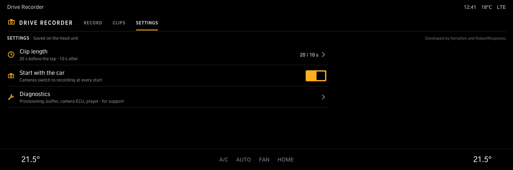
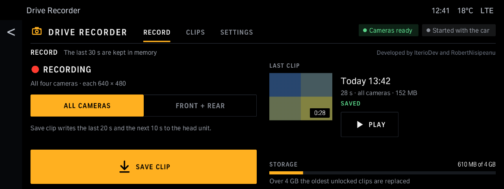
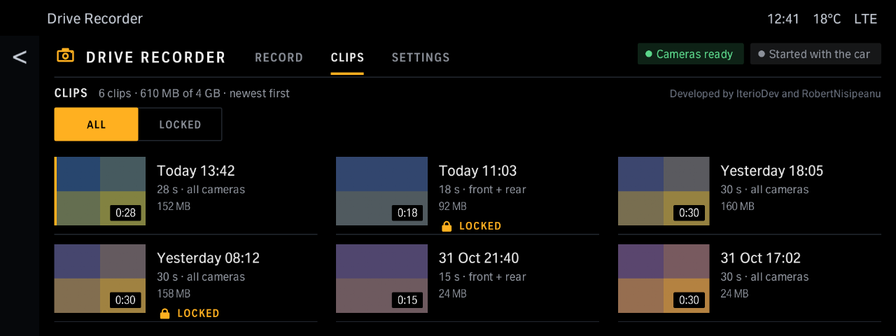
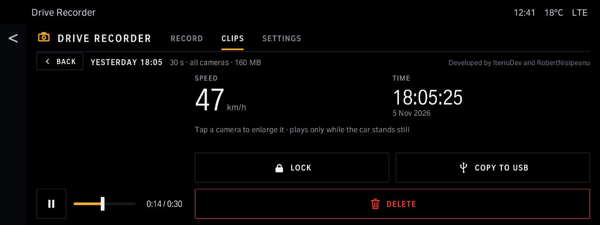

# Drive Recorder

Keeps the car's cameras recording and saves a clip when you ask; watch, lock, delete and copy clips to a USB stick while the car stands still. Over 4 GB the oldest unlocked clips are replaced. The Store installs the Drive Recorder player with it. The car must be coded for the Drive Recorder.

Version 2.3.13 · iDrive 7 and iDrive 8 · package `oap-driverecorder-next` · [all apps and how to install](../../README.md)

> [!NOTE]
> Car-tested (2.0.1, iDrive 8): recording, saving and watching clips. 2.3.0 did not start on the car (its manifest lacked what the new app host needs); 2.3.1 fixes that. Not tested on a car yet: the 2.2.0 screens, Copy to USB, and 2.3.1's new app host (the Store's, on iDrive 8 too). The car must be coded for the Drive Recorder; the Store installs the Drive Recorder player with the app.

> [!NOTE]
> **iDrive 7, car-tested** (2.3.5 to 2.3.12 with the players 1.1.2 to 1.1.4, a G20 without BMW's online services): it installs, starts, opens all its pages, finds and records all four cameras, saved full 91 s clips and copied them to a USB stick (as recorded and as one camera's MP4). The player raises BMW's 1 GB storage budget for the clips to 4.5 GB and makes the stick writable while *Copy to USB* needs it ([details](../../README.md#drive-recorder-tool-iteriodev-drplay)). Not tested on iDrive 7 yet: a save after the budget was raised, watching clips, a car with BMW's online services.

> [!IMPORTANT]
> A car provisioned online by BMW (Diagnostics: *Provisioning data state: OTA*) reads no app lines from its das files, so the player's provisioning lines do nothing there: the camera service records only if BMW's own provisioning for that car enables the Drive Recorder. Diagnostics then says *Provisioning flag not set by BMW* ([details](../../README.md#drive-recorder-tool-iteriodev-drplay)).

## Screens

Screens from the app's offline test against a simulated car, so the values are made up. The climate bar along the bottom is the test's stand-in for the car's own; on iDrive 7 the test draws a stand-in for the HMI's title strip and back arrow.

### Record

The last 30 s are kept in memory. *Save clip* writes the 20 s before and the 10 s after; all cameras or front + rear.

### Clips

Newest first, all or only the locked ones. Over 4 GB the oldest unlocked clips are replaced.

### Watching a clip

Speed and time of the clip, *Lock*, *Copy to USB* and *Delete*. Plays only while the car stands still.

### Copy to USB

All cameras as recorded, or one camera.

### Settings

Clip length, start recording with the car, Diagnostics.

### iDrive 7

The same pages, laid out for iDrive 7's screen (1920 × 720).

