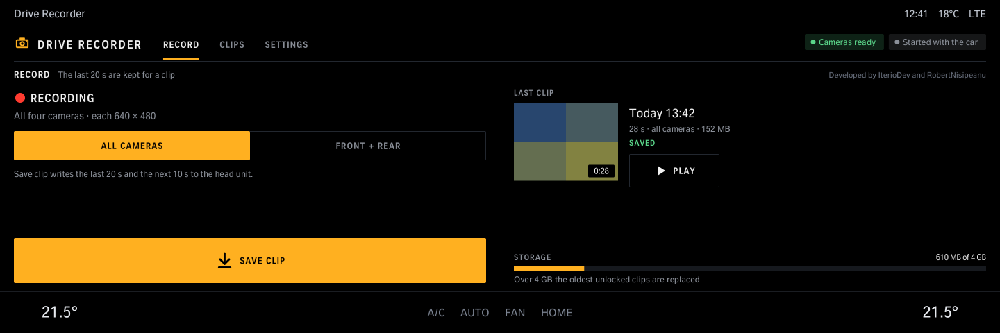
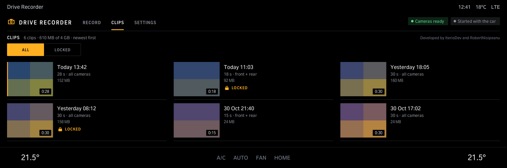
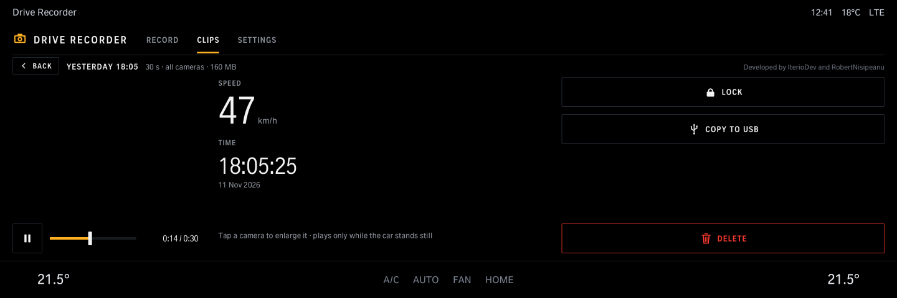
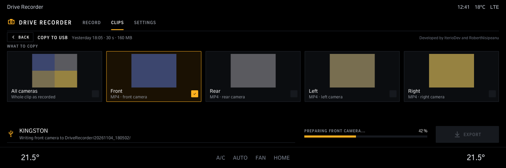
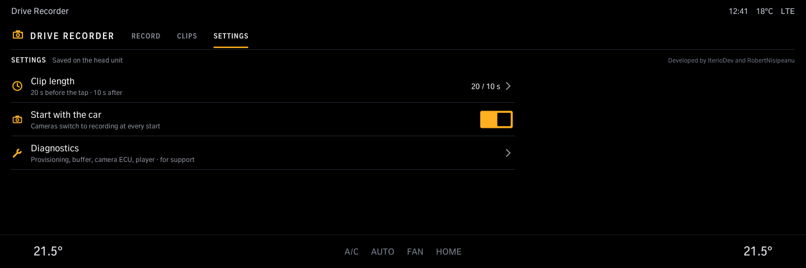
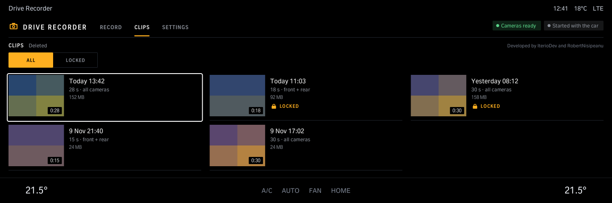
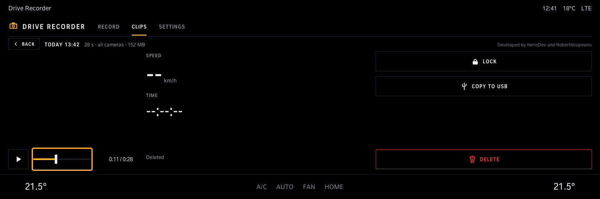
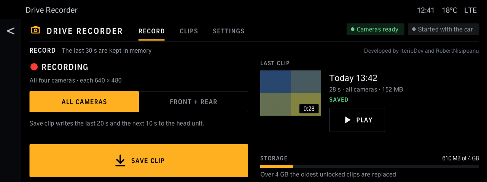
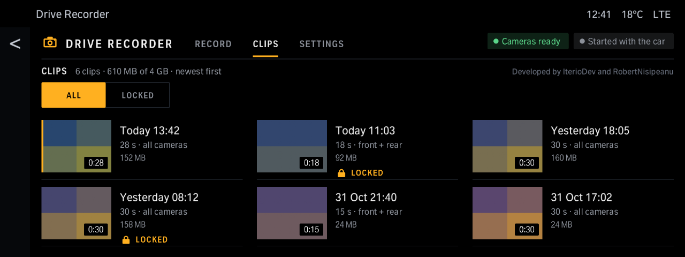
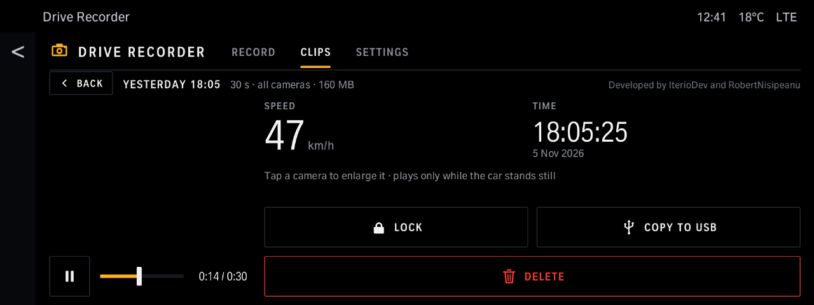

# Drive Recorder

Keeps the car's cameras recording and saves a clip when you ask; watch, lock, delete and copy clips to a USB stick while the car stands still. Over 4 GB the oldest unlocked clips are replaced. The Store installs the Drive Recorder player with it.

Version 2.5.2 (player `iteriodev-drplay` 1.2.6) · iDrive 7 and iDrive 8 · package `oap-driverecorder-next` · [all apps and how to install](../../README.md)

> [!NOTE]
> **Car-tested** (2.4.0 with the player 1.2.3, iDrive 8, G82 with the 360 cameras): recording, saving and watching clips with all cameras. Not tested on a car yet: Copy to USB of these clips (player 1.2.4), front + rear only cars, 2.4.0 on iDrive 7, the iDrive controller (2.5.0).

From 2.4.0 the player records the camera unit's stream with its own receiver (`mgu-driverec-rx`) instead of the head unit's camera service. BMW's provisioning no longer matters: cars provisioned online by BMW (*OTA*) record too. The camera unit still has to take its Drive Recorder mode; a car whose camera unit refuses it shows *No drive-recorder cameras found* ([details](../../README.md#drive-recorder-tool-iteriodev-drplay)).

> [!IMPORTANT]
> After installing or updating to 2.4.0, restart the head unit once: the receiver is a new service and starts at the next start.

## Screens

Screens from the app's offline test against a simulated car, so the values are made up. The climate bar along the bottom is the test's stand-in for the car's own; on iDrive 7 the test draws a stand-in for the HMI's title strip and back arrow.

### Record

*Save clip* writes the 20 s before and the 10 s after; all cameras or front + rear.

### Clips

Newest first, all or only the locked ones. Over 4 GB the oldest unlocked clips are replaced.

### Watching a clip

Speed and time of the clip, *Lock*, *Copy to USB* and *Delete*. Plays only while the car stands still.

### Copy to USB

All cameras as recorded, or one camera as an MP4 with date, time and speed on it.

### Settings

Clip length, start recording with the car, Diagnostics.

### iDrive controller

For cars without a touchscreen (2.5.0; 2.5.1: the ring follows the screen you are on and stays inside an open dialog): turn the controller and a white ring goes from control to control; push it up, down or right to jump that way. Press to tap the ringed control. On the clips the ring goes from clip to clip and the list scrolls along. In a clip, each camera is a stop (press to enlarge it, press again or *All cameras* for all four), then play / pause and the timeline: press it once (the ring turns amber), turn to move 1 s a click, press again when done. The first turn only shows the ring; touching the screen hides it. Push left or BACK leaves the page as usual.

### iDrive 7

The same pages, laid out for iDrive 7's screen (1920 × 720).

